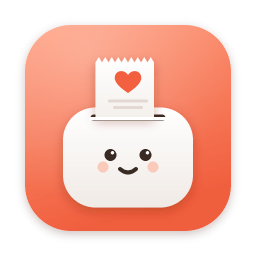
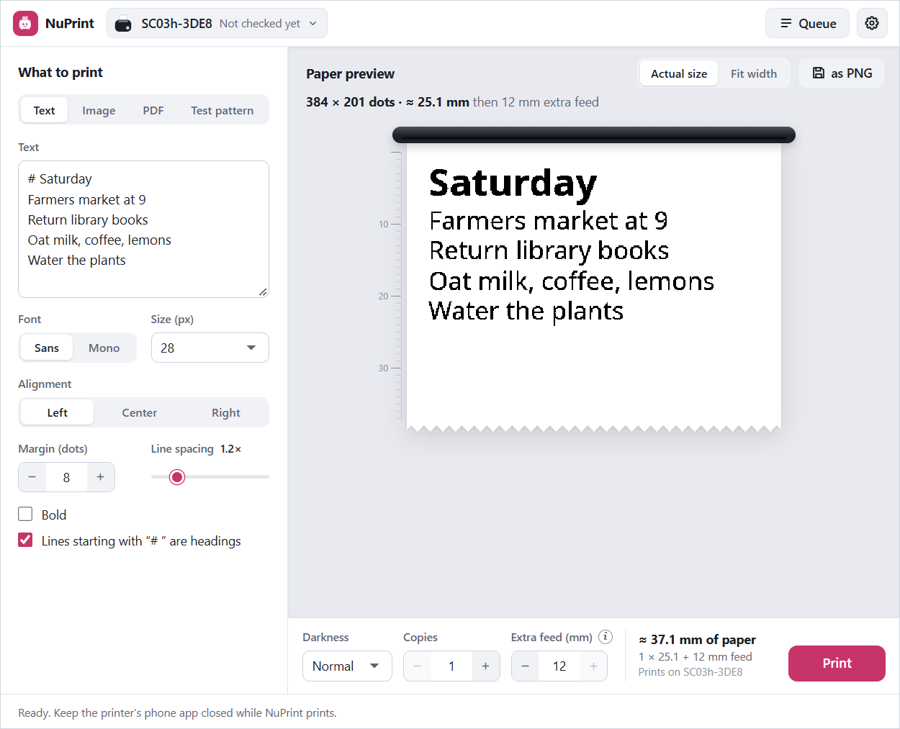
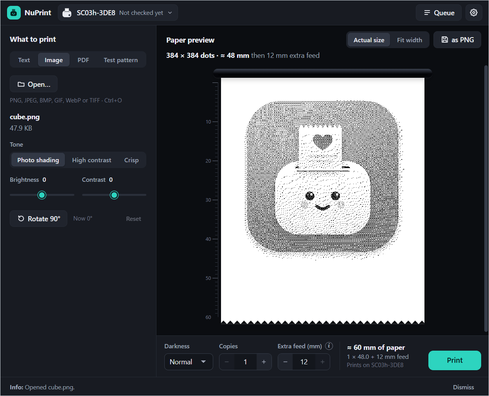

  

<h1 align="center">NuPrint</h1>

  Print notes, pictures and PDF pages from your computer to a pocket Bluetooth thermal printer. 
  No phone app, no pairing, no printer driver.

  
  
  
  

  

## What it does

- **Write, open, print.** Type a note with headings, or open a picture or one page of a PDF.
- **See the exact print.** The preview is the bitmap the printer will receive, dot for dot, with a millimetre ruler and a paper estimate.
- **Talks to the printer directly.** NuPrint finds the printer over Bluetooth LE and sends the job itself. Nothing to install on the printer side.
- **A queue you can trust.** Jobs survive a restart, can be cancelled, and are never resent on their own if a transfer was interrupted.
- **Private.** Documents never leave your computer, and diagnostics hide device names and job titles unless you include them.
- **Yours to style.** Light or dark, four accent colours and four app icons.

  
  

## Download

Get the installer for your system from the [latest release](https://github.com/wapenshaw/nuprint/releases/latest).

| System | NuPrint | NuPrint Slint |
| --- | --- | --- |
| Windows 10 and 11 | `NuPrint_<version>_x64-setup.exe` | `nuprint-slint_<version>_x64-setup.exe` |
| macOS 14+ on Apple silicon | `NuPrint_<version>_aarch64.dmg` | `nuprint-slint_<version>_aarch64.dmg` |
| macOS 14+ on Intel | `NuPrint_<version>_x64.dmg` | `nuprint-slint_<version>_x64.dmg` |
| Debian and Ubuntu | `NuPrint_<version>_amd64.deb` | `nuprint-slint_<version>_amd64.deb` |
| Fedora and openSUSE | `NuPrint-<version>-1.x86_64.rpm` | the AppImage below |
| Any other Linux (x64) | `NuPrint_<version>_amd64.AppImage` | `nuprint-slint_<version>_x86_64.AppImage` |

The Windows installers need no admin rights. Once installed, both apps can check for a newer release and install it in **Settings → Updates**. They check only when you ask, or at start if you turn that on.

### Two apps, one engine

NuPrint comes in two editions. They look and work the same, and share the same printing engine: rendering, printer support and the job queue.

- **NuPrint** draws its window with the system's web view (through [Tauri](https://tauri.app)). It is the main app and the one tested on paper, on Windows and macOS.
- **NuPrint Slint** draws its window natively with [Slint](https://slint.dev), with no web view involved. It is newer: its screens have been checked on Windows, but printing from it has not been tested on paper yet, and it [lacks two small options](docs/building.md#slint-app).

Both can be installed side by side. Each keeps its own printers and queue.

### Signing

The installers aren't code-signed yet, so Windows and macOS warn on first launch; the [user guide](docs/user-guide.md#installing) shows how to get past the warning. Windows signing through the free [SignPath Foundation](https://signpath.org) programme is planned. The Mac apps are not notarized, which needs a paid Apple developer account.

From the next release on, every installer comes with a GitHub build attestation: a signed record that it was built by NuPrint's release workflow from this repository. [Check a download](docs/code-signing.md#check-a-download) shows how to verify one, and the [code signing policy](docs/code-signing.md) has the details.

## Get printing

1. Turn the printer on and close its phone app.
2. In NuPrint, open the printer button in the toolbar and choose **Find printers…**, then **Save printer**.
3. Write a note or open a picture or PDF page.
4. Press **Print**.

The [user guide](docs/user-guide.md) covers the queue, advanced printer settings, appearance, updates and troubleshooting.

## Printers

| Printer | Status |
| --- | --- |
| ZEITEL **SC03h** (names starting `SC03h-`) | Tested on Windows, macOS and Linux. |
| 34 models with the same vendor-app settings, such as X2h, X5h, X6h, SC04h, P1 and D1 | Experimental: offered with a badge and a confirmation, not yet tested on hardware |

Other printers show up as unknown devices and are never sent print commands. If you own one of the experimental models, a [printer report](https://github.com/wapenshaw/nuprint/issues/new/choose) is the fastest way to get it supported. See [supported printers](docs/user-guide.md#supported-printers) for the details.

## Documentation

- [User guide](docs/user-guide.md): installing, printing, the queue, settings and troubleshooting
- [Command line](docs/printer-interaction.md): the `nuprint` tool for scanning, previews and printing
- [Building from source](docs/building.md): development setup, checks and the repository layout
- [Code signing policy](docs/code-signing.md): what is signed and how to check a download
- [All documentation](docs/README.md): architecture, printer protocol, validation records and the roadmap

## Contributing

Bug reports, printer reports and pull requests are welcome. Start with [CONTRIBUTING.md](CONTRIBUTING.md), report security problems as described in [SECURITY.md](SECURITY.md), and follow the [code of conduct](CODE_OF_CONDUCT.md).

## Licence

NuPrint is released under the [MIT License](LICENSE). The bundled Noto fonts are under the SIL Open Font License ([OFL.txt](crates/nuprint-render/assets/fonts/OFL.txt)). PDFium is downloaded at build time under its own licence and is not part of this repository.

NuPrint is an independent project, not affiliated with, endorsed by or supported by ZEITEL or the makers of the printers' vendor app. Product names only identify compatible hardware. The printer protocol was implemented independently for interoperability, from hardware observations and analysis of the vendor's Android app; the evidence is in [docs/protocol.md](docs/protocol.md), and no vendor code or app files are included.
