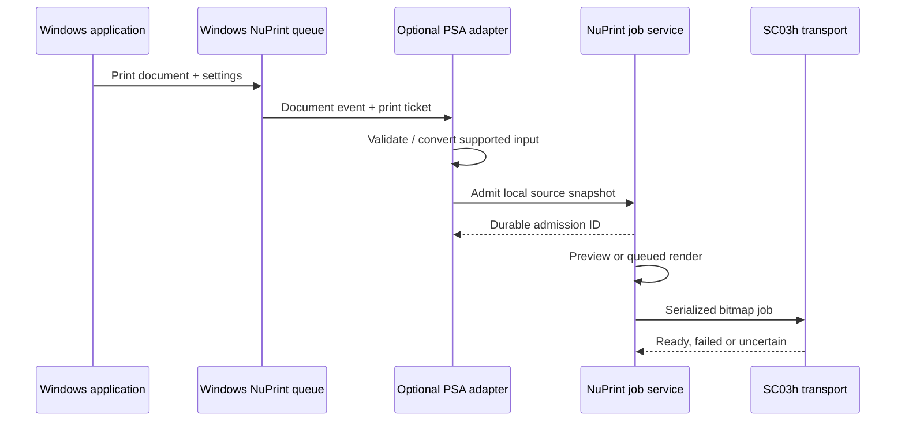

# Deferred: Windows system-printer integration

Status: **deferred beyond V1; no release assigned**. Revisit only as a separately requested task. This document preserves research and possible future requirements; nothing here is a V1 implementation or release criterion. No Windows printer queue is installed by NuPrint today. Sources checked 2026-10-12; recheck platform APIs when this work resumes.

V1 is defined by the [product specification](../app-spec.md) and [Rust + Tauri specification](../rust-tauri-spec.md): direct Bluetooth printing from NuPrint's app and CLI, with its own internal job queue. Standard Windows Print-dialog integration is separate future work.

## Tradeoffs for an ordinary user

Using NuPrint as a normal Windows printer means adding a virtual queue to Windows. That queue still needs a running local component to turn documents into model-specific Bluetooth commands. It does not make the SC03h understand normal document formats by itself.

| Aspect | Benefit of a Windows queue | Cost or limitation |
| --- | --- | --- |
| Existing applications | Print directly from Word, browsers, PDF viewers and other apps with a Print command | Each application's sizing/page-range behavior needs testing |
| Daily convenience | No manual export-to-PDF/import step; familiar printer selection and copy controls | Optional bridge must be installed and reachable, including when the editor is closed |
| Document conversion | Windows supplies a document stream to the virtual printer | Conversion, fonts, margins and narrow media support still require implementation |
| Layout | Apps that support custom small paper sizes can target the roll directly | A4 content can shrink to unreadable text; the queue cannot infer which paragraph/photo to crop |
| Queue and cancellation | Familiar Windows job controls | Windows spool status and BLE/paper state can differ; buffered rows may print after Cancel |
| Quality | Same Rust renderer/profile presets can be reused | OS scaling or app rasterization may degrade text/codes; preview remains useful |
| Reliability | All entrypoints can share the durable NuPrint dispatcher | More processes/lifecycles and possible ambiguous partial jobs; duplicate prevention is necessary |
| Multiple models | Separate saved queues can route to specific verified model profiles | Queue capabilities must reflect the target; a model change may require capability refresh/reinstallation |
| Portability | Useful Windows-specific convenience | Does not supply macOS/Linux Print-dialog integration automatically |
| Deployment | Modern virtual-printer APIs may avoid a custom legacy driver | OS/API support, package registration, signing and clean removal still need validation |

Recommendation if this task resumes after V1: keep the Windows queue as an optional entrypoint to the same Rust service. Default OS-originated jobs to NuPrint preview/approval for narrow-paper layout; let users opt into direct dispatch for well-tested templates. Normal printing should not require recurring confirmation after that explicit preference is set.

Do not advertise it as a faster printer or a way to improve the physical head's resolution. The physical width, thermal paper, monochrome output and Bluetooth transfer constraints remain. For quick notes, cropped photos and labels, NuPrint's own editor gives clearer control; for frequent printing from existing apps, the Windows queue is convenient.

## Desired behavior

A Windows application offers a printer named NuPrint. Selecting it submits the requested pages and copies to the same local preview/queue service used by the desktop editor, which renders and sends SC03h BLE packets. The Bluetooth printer itself is not an IPP printer based on the evidence collected here.

Keep any future integration optional. A failure or unsupported Windows version must leave the Rust + Tauri direct desktop app working. The Python application remains the current implementation; the Rust backend is specified for V1, while this queue adapter is deferred.

## Preferred feasibility study: Print Support App virtual printer

Microsoft documents a Print Support App v4 virtual-printer architecture registered through an app package/MSIX manifest. It provides document events, print-ticket handling and conversion APIs. Preferred input is OXPS or PostScript; PDF can be declared for supported passthrough. Omitting `OutputFileTypes` avoids the save-to-file printer behavior. [Microsoft design guide](https://learn.microsoft.com/en-us/windows-hardware/drivers/devapps/print-support-app-v4-design-guide).

These APIs establish a possible platform mechanism, not NuPrint compatibility. Determine minimum Windows build/SDK, package identity requirements, background-task lifetime and IPC access using an executable proof of concept before choosing the adapter implementation. A small C#/WinRT adapter is a candidate; it would submit to the shared Rust service rather than reimplementing printer drivers. Keep the adapter outside the portable Rust core.

Proposed flow:

Define whether the Windows job completes on durable admission or after printer readiness. If framework lifetime limits require early completion, state clearly that Windows acknowledged handoff and that NuPrint owns subsequent status; never describe handoff as physical printing.

### Proof-of-concept acceptance

1. Register a test virtual queue on a documented Windows build and remove it cleanly.
2. Receive documents from Notepad, Edge PDF printing and a desktop document editor. Record actual content types; do not assume every application supplies PDF.
3. Convert all advertised input formats to a rasterable source, preserving page order, print-ticket page ranges, orientation and copies without applying them twice.
4. Transfer the job through authenticated per-user IPC to the existing app's admission path. Prove behavior with the UI initially closed.
5. Demonstrate narrow media sizing, the selected profile's dot width (384 for SC03h), and a preview-first workflow without changing verified model heat/protocol settings.
6. Verify cancellation, malformed input, missing Bluetooth, service restart and shutdown. Bound spooling and resource use.
7. Validate update/uninstall, package signing requirements, declared OS minimum and Windows Protected Print behavior.

No compatibility claim should precede these results. Keep prototype code and package changes distinct from the release app until the adapter passes.

Prefer one queue per saved printer/profile association so a Windows submission cannot silently follow whichever device was last selected in the editor. Apply copies and page ranges once, accounting for what the submitting app/Windows has already rendered. Persist the OS job ID ↔ NuPrint job ID mapping for cancellation and status correlation.

## Alternative feasibility study: local IPP bridge

A loopback IPP endpoint could translate Windows submissions into the local job service. This is a fallback investigation, not a promised drop-in driver. It must prove Windows queue installation, supported document formats, media capabilities and spooler semantics on the actual target builds.

If attempted, advertise only implemented document formats/capabilities and implement the operations exercised by Windows: printer attributes, validate/submit job, query job state, cancel, and any multi-document flow observed during the spike. Implement bounded request parsing and spool admission. Test delayed printer availability without falsely acknowledging physical success.

Bind to loopback, avoid LAN discovery/exposure by default, enforce request limits and timeouts, and keep transport ownership in the existing dispatcher. Record exact installer commands only after they are tested; this document intentionally does not present an unverified `Add-Printer` recipe.

## Approaches not selected

A custom legacy driver/port monitor adds deployment, signing and compatibility work before proving benefit for this device. Microsoft documents that Protected Print disables third-party driver loading. That affects the integration choice; it does not mean a new local bridge automatically qualifies as compatible. [Microsoft enterprise/developer guidance](https://learn.microsoft.com/en-us/windows/modern-print/windows-protected-print-mode/more-information-on-windows-protected-print-mode-for-enterprises-and-developers).

Do not change the user's Protected Print settings, install drivers, register queues or add startup services merely to complete the specification. Implement/install the optional integration when that work is requested.

## Decision record required after the spike

Record chosen mechanism, minimum OS/build, packaging identity, input formats, conversion component, media description, IPC permissions, job-completion semantics, installation/removal behavior and measured failure handling. Link source commits and test evidence. If neither path passes, retain PDF import as the supported workflow and mark standard Print-dialog integration unavailable.
