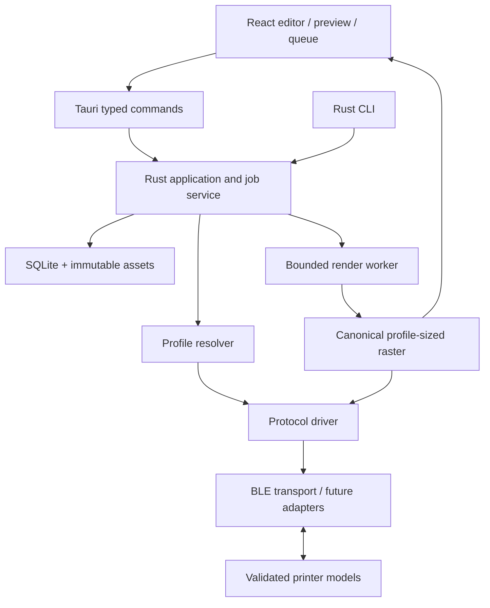

# NuPrint: Rust + Tauri cross-platform specification

Status: implemented as the workspace in this repository (version 1.0.0); see [validation.md](validation.md) for what has been verified per OS. Decision date: 2026-10-12. This replaces the previous proposal to expand the Python/Tk application. The Python v0.1 app remains the verified reference and working fallback during migration.

## 1. Scope and decisions

Build one desktop product for Windows, macOS and Linux, with a shared Rust printer engine and a Tauri 2 shell. The same engine serves the desktop UI and a diagnostic CLI. V1 delivers direct Bluetooth printing through these entrypoints. No Python installation or bundled Python service is required by the finished Rust app.

Support multiple printer models through explicit protocol implementations and versioned model profiles. The first port is the verified lowercase SC03h. A second physical model must be added before declaring the multi-model architecture proven. A device appearing in discovery is not evidence that it can be printed to.

| Layer | Selected direction | Reason / constraint |
| --- | --- | --- |
| Desktop shell | Tauri 2 | Windows/macOS/Linux packaging and native host APIs |
| Frontend | TypeScript + React + Vite | Shared editor, preview and queue UI; frontend choice is a project decision, not a printer requirement |
| Core | Rust workspace, stable toolchain pinned at implementation | Shared domain, renderer, protocol and job service |
| Async I/O | Tokio | Device actors, bounded channels, cancellation and deadlines |
| BLE | `btleplug`, behind our transport interface | Required central-mode operations on all three desktop OS families |
| Storage | SQLite through `rusqlite`, bundled SQLite | Durable jobs/settings/migrations; database access stays in Rust |
| Data contracts | Serde types; generated TypeScript declarations | Avoid mismatched hand-maintained UI/backend schemas |
| Images | Rust `image` crate candidate | Decode, transform and raster operations; verify formats/limits before pinning |
| PDF | Native PDFium via `pdfium-render` candidate | Port existing PDF behavior; native binaries and licenses are part of packaging |
| Text | Rust-owned layout/shaping and rasterization | Font/glyph selection must produce the same canonical bitmap used for printing |
| Preview | PNG or bounded tiled images generated by Rust | WebView/CSS rendering must not determine the printed pixels |

Exact dependency versions, text/shaping library and bundled-font choice are resolved in the first implementation milestone and locked. Do not silently fall back to HTML screenshots or OS-native text rendering for canonical output. Run a glyph/layout proof of concept before finalizing the renderer.

[Tauri](https://v2.tauri.app/start/) supports a web frontend backed by Rust and uses system WebViews. This is a desktop application; printing is implemented in Rust, not through browser Web Bluetooth.

## 2. Architecture and workspace



Proposed paths, created only when implementation begins:

```text
Cargo.toml / Cargo.lock / rust-toolchain.toml
apps/desktop/                  React frontend and its npm lockfile
apps/desktop/src-tauri/         Tauri host, permissions and packaging
crates/nuprint-core/           Jobs, domain types, storage, profile resolution
crates/nuprint-protocol/       Pure framing, codecs and protocol state machines
crates/nuprint-transport/      Transport traits and btleplug backend
crates/nuprint-render/         Text/image/PDF to canonical raster
crates/nuprint-cli/            Headless diagnostics and print entrypoint
profiles/                      Reviewed model profiles and schemas
fixtures/                      Synthetic raster vectors and sanitized replies
```

The Rust core does not depend on Tauri, React, Windows-only APIs or a running WebView. Protocol code must be testable without Bluetooth. Platform APIs live in transport and desktop host/packaging code. Prefer modules within these crates until an additional crate has a real ownership/build benefit.

## 3. Frontend/backend boundary

Rust owns printer matching, file admission, render validation, settings bounds, database writes, job state and all Bluetooth activity. The frontend owns interaction and presentation. Never expose a general raw-GATT-write, shell-execution or arbitrary protocol-packet command to the editor.

Proposed command surface:

| Command | Input / result |
| --- | --- |
| `start_scan`, `stop_scan` | Bounded discovery session ID; device events carry that ID |
| `inspect_device` | Discovery ID → service identity and profile candidates; no speculative writes |
| `select_profile` | Candidate/profile revision → validated or explicitly experimental association |
| `check_printer` | Selected device/profile → supported status fields and readiness evidence |
| `import_source` | Native-dialog-selected file or clipboard payload → app-managed source ID |
| `render_preview` | Source/design ID + settings + generation → raster snapshot ID and preview assets |
| `enqueue_job` | Snapshot ID + target + copy settings + idempotency key → durable job ID |
| `cancel_job`, `hold_queue`, `resume_queue` | Job/queue ID → acknowledged intent; terminal state arrives later |
| `list_jobs`, `get_job` | Authoritative state/revision for reconnecting views |
| `save_design`, `load_design` | Versioned design and asset references |
| `export_diagnostics` | Reviewed fields → native save dialog; source content excluded by default |

All commands validate sizes, IDs, ownership and capability constraints in Rust. Do not pass document contents, huge raster arrays or arbitrary paths repeatedly over JSON IPC. Serve bounded previews through a scoped local asset mechanism; keep source/raster bytes in Rust-managed storage.

Print settings include profile-bounded trailing feed, separate from raster margins. Rust resolves nominal millimetres to driver units and snapshots requested/effective values with the job. The UI displays image length plus explicit page/copy gaps plus final feed; only the final page/copy gets the trailing feed. SC03h parity includes 0–12 whole nominal mm, default 12, with zero emitting no post-image feed commands. Persist this setting per printer in M3; other models require their own feed capability and calibration evidence.

Events include request ID, job/attempt ID where applicable, sequence number and state revision. Throttle progress events; never drop terminal results or depend on an event alone for durable state. Reopening a window queries the current snapshot before subscribing to changes. Reject stale preview generations and bind Print to the displayed raster snapshot.

Configure Tauri capabilities for the intended windows and necessary commands/plugins; test rejection of unauthorized calls. Capabilities do not replace application validation or automatically secure every custom command. Ship local UI assets, restrict content loading, and render imported/user text as data. [Tauri capabilities reference](https://v2.tauri.app/security/capabilities/).

## 4. Device ownership and concurrency

One application service owns the local queue. A single actor owns each connected printer and serializes its command stream. Initially permit only one active Bluetooth print across devices until adapter concurrency has been measured. Users may save multiple printers and route jobs to them without enabling concurrent hardware writes.

Use bounded Tokio channels, explicit cancellation and phase deadlines. UI closure cannot interrupt a packet stream without recording cancellation/uncertainty. Finish disconnect cleanup before admitting another session for the same device. Process shutdown holds pending jobs and persists active attempt outcomes; background/tray mode is opt-in.

Run CPU-heavy render work away from the Tauri event loop. Serialize PDFium access within a process. A dedicated renderer process is preferred for hard time/memory limits on imported PDFs; timing out a future does not stop native library execution. Lock and bundle the PDFium build for every shipped target. The Rust wrapper still requires a compatible native PDFium library. [pdfium-render project](https://github.com/ajrcarey/pdfium-render).

The durable state machine and storage contracts in [technical-spec.md](technical-spec.md) apply. Profile-specific completion evidence determines whether UI says **printer ready** or **transfer complete; output unconfirmed**. An uncertain partial send never triggers automatic replay.

## 5. Platform matrix and obligations

These are initial product test targets, not already-verified support claims or upstream minimum requirements:

| Platform | Initial release target | Platform-specific acceptance |
| --- | --- | --- |
| Windows | Windows 11 x64 | Packaged BLE on a non-admin account; WebView2 availability; adapter off/on and sleep/wake |
| macOS | macOS 14+ Apple Silicon; Intel build gated by test hardware | Bluetooth usage text/permissions; signed/notarized app; denial/regrant; sleep/wake |
| Linux | Ubuntu 24.04 LTS x64 first | BlueZ/D-Bus access; WebKitGTK runtime; X11 and Wayland sessions; no requirement to run app as root |

Build separate artifacts per OS/architecture. An AppImage does not eliminate host Bluetooth, D-Bus or graphics dependencies. Other Linux distributions, Windows ARM64 and macOS Intel are expansion targets requiring release evidence. Resolve the exact minimum runtime versions from the selected dependencies and record them before release. [Tauri prerequisites](https://v2.tauri.app/start/prerequisites/).

`btleplug` supports desktop BLE discovery, GATT operations and notifications; it does **not** implement Classic Bluetooth/SPP. macOS identifiers are not portable MAC addresses, and its application bundle needs the appropriate Bluetooth usage description. Linux scan results require application-level filtering. Use an app-local device UUID with an OS-scoped backend identity; rescan and revalidate on each new session. [btleplug platform notes](https://github.com/deviceplug/btleplug).

User-facing states distinguish permission denied, adapter absent, adapter off, no matching device, unsupported profile and connection failure. Do not ask for a MAC address on macOS or recommend running the Linux app as root to bypass permissions. Any distro-specific setup must be verified and explained separately.

Use platform application-data/cache directories through the host's path APIs. Store document assets outside the application installation folder. Windows named pipes and Unix-domain sockets are platform adapters for CLI handoff; direct Tauri-to-core calls do not need a separate local HTTP server.

## 6. Multi-printer support

Follow [printer-support.md](printer-support.md). Three independent concepts are mandatory:

1. **Transport:** how bytes move, initially BLE/GATT. Future Classic/SPP or USB requires another tested backend.
2. **Protocol:** how requests, rasters, status and flow control are represented, such as the verified SC03h packet family.
3. **Model profile:** which variant/firmware uses that protocol, with its own width, packing, heat presets, service bindings and limits.

The UI reads capabilities from the selected profile. It must not hardcode 384 pixels, SC03h energy, A3 readiness, A2 rows or an AE01 write channel for every device. The renderer uses the profile's dimensions; the protocol driver controls wire packing and sequencing. Unsupported controls are absent or explained, never silently ignored.

## 7. Migration milestones and release gates

| Milestone | Deliverable | Exit evidence |
| --- | --- | --- |
| M0: foundations | Rust workspace and Tauri skeleton; pin libraries; prove text/PDF rasterization and native packaging | Builds on all target runners; runtime/render licenses and native dependencies recorded |
| M1: SC03h parity | Rust codec, decoder, BLE diagnostics and short-print CLI | Golden packet/raster tests match Python for identical binary inputs; Windows physical strip matches baseline |
| M2: desktop parity | Text/image/PDF, native file dialogs, exact preview, darkness, adjustable trailing feed, cancel and diagnostics | Same bitmap used for display/transmission; packet parity for zero/reduced/default feed; packaged discovery/status/short print on Windows, Mac and Linux |
| M3: product features | Durable jobs, saved printers/settings, transforms/page ranges, templates | Recovery, quotas, stale-preview, cancellation and UI acceptance pass |
| M4: second printer | One additional physical model through the registry; prefer another protocol family | No editor/job-service changes required; model-specific fixtures, capabilities and paper evidence |
| M5: release | Install/update/uninstall, accessibility, signing and documentation | Published OS/model/firmware verification matrix; independent clean-machine packages |

Do not rewrite/delete Python files as part of this specification task. During implementation, keep them runnable alongside the Rust workspace until parity is established.

Python tests serve as an oracle for protocol vectors, not a permanent runtime dependency. Compare encoded bytes for identical canonical monochrome inputs. Text/PDF raster output may differ with rendering libraries; validate reviewed output and font fixtures rather than forcing accidental Pillow implementation details into Rust.

## 8. Test and distribution plan

When the workspace exists, CI should run Rust formatting, Clippy and locked tests; frontend type checking/component tests; profile-schema validation; cross-language packet-fixture comparisons; and native builds on all three OS runners. These are planned checks, not commands claimed to run in today's Python repository.

Fuzz length/CRC/status parsers and profile matching. Mock transport failures and backpressure; hardware tests remain explicit and separate from ordinary CI. Exercise bundled PDFium and Bluetooth after packaging, not just unit tests on a development machine.

Web frontend tests do not prove native app behavior. Use Tauri automation where supported and a documented native/manual route on macOS; Tauri's current WebDriver documentation does not provide equivalent macOS desktop coverage. [Tauri WebDriver support](https://v2.tauri.app/develop/tests/webdriver/).

Ship a Windows installer, macOS app/DMG and an initially supported Linux package format, with tested dependency handling. Sign/notarize as applicable and publish hashes/license notices. Native runtime/library support and installer behavior must pass per target; a successful Rust cross-compile is insufficient. [Tauri distribution](https://v2.tauri.app/distribute/).

## 9. Open engineering gates

- Choose and test text shaping/rasterization plus redistributable fonts across the intended scripts.
- Pin compatible PDFium builds and measure cold start, render memory and package size on each target.
- Confirm btleplug exposes the write-limit information needed on each pinned backend; otherwise start with conservative 20-byte writes and an explicit transport limit. Never infer a safe write size from SC03h's observed Windows MTU on another OS.
- Obtain a second physical printer and its documentation/app evidence; select the protocol adapter based on that hardware.
- Determine actual platform minimums and publisher/signing identities from available release infrastructure.

These are bounded implementation investigations, not reasons to change the chosen Rust + Tauri direction or claim universal Bluetooth-printer support.
