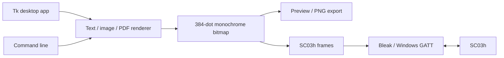
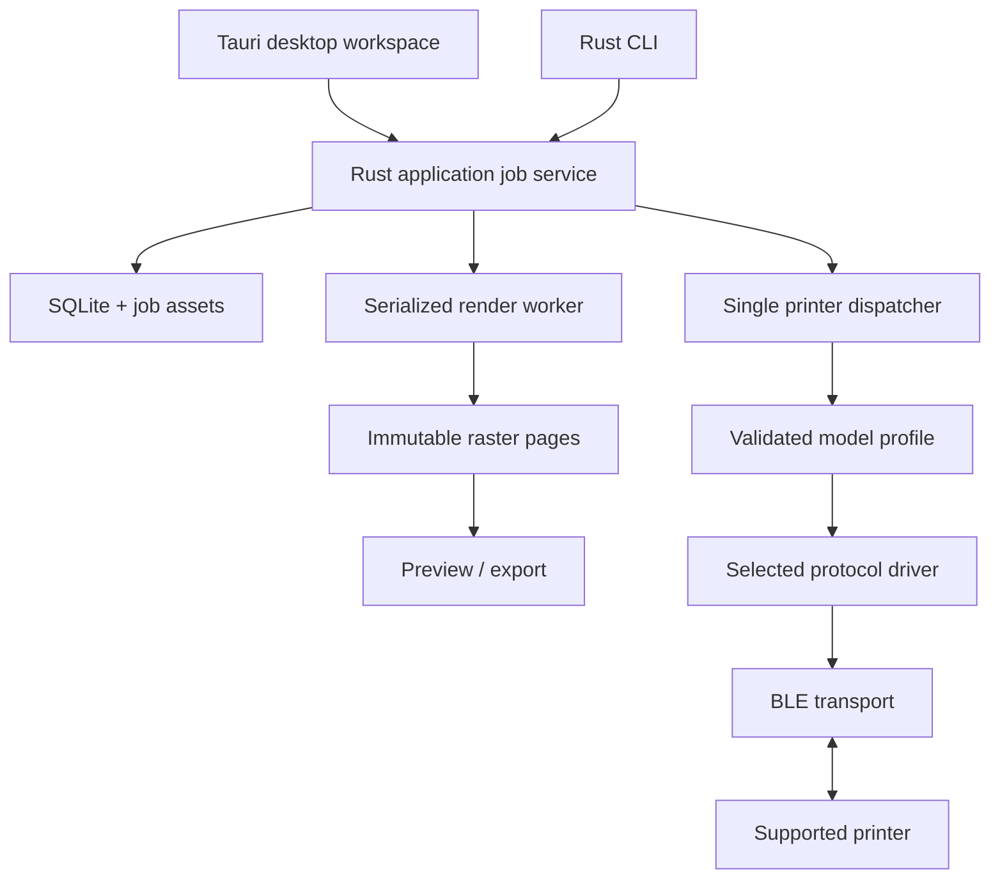
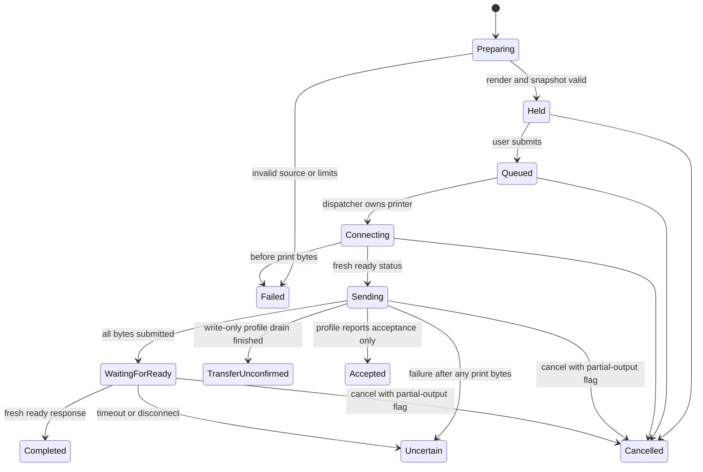

# NuPrint technical specification

Status: section 1 describes the Python PoC (`poc/python`); later sections describe the Rust application, now implemented in `crates/` and `apps/tauri` except where marked proposed. Updated 2026-10-12. [rust-tauri-spec.md](rust-tauri-spec.md) defines the selected stack and migration; [printer-support.md](printer-support.md) defines model/protocol extensibility.

## 1. Implemented baseline

Python package `nuprint`, product NuPrint 0.1.0. `pyproject.toml` requires Python 3.11+; the executable was built with Python 3.14.7. Runtime dependencies are Bleak 3.0.2, Pillow 12.3.0 and pypdfium2 5.14.0. The Tk GUI is packaged with PyInstaller. `uv.lock` captures resolved dependencies; `uv sync --extra dev --locked` installs the development environment.



`print_job()` is pure: it validates and encodes the whole page before opening Bluetooth. `connect()` scans for the device, connects, validates its service/write channel, subscribes to status channels and disconnects in a `finally` block. `print_image()` gates a transfer on a fresh A3 response, sends paced chunks and polls for ready after a settling delay.

The current GUI uses a thread per operation with its own `asyncio.run()` lifetime. Tk calls remain on the main thread; a queue carries log/progress/status messages. Rendering currently happens on the GUI thread. There is no durable job queue, cross-process device ownership, saved template format, IPC endpoint or Windows print-queue registration in this baseline.

Current implementation constraints:

| Concern | Current behavior |
| --- | --- |
| Model selection | Lowercase `SC03h-` prefix; name/address targeting |
| Raster | Mode `1`, 384 pixels wide, 1–4000 rows |
| Extra feed | Integer 0–12 nominal mm, default 12; zero omits post-image feed; current GUI setting is session-only |
| Text | Windows Segoe UI when present; 12–64 pixel font size; 20,000-character input bound |
| PDF | One selected page; render at 2× target width then convert |
| Discovery | Scan 8 seconds; selected-device lookup 30 seconds (the printer was seen taking about 9 s to reappear after idle on 2026-10-14; a scan stops as soon as it is found) |
| Connection | 25-second outer deadline; uncached Windows GATT discovery |
| Subscribe/write | 10 seconds per subscription/write |
| Status | Fresh reply required within 3 seconds |
| Flow control | Up to 20 seconds waiting for buffer resume |
| Transport pacing | ≤180 bytes; 25 ms/chunk; 250 ms near 4 KiB boundaries |
| Post-transfer | 2-second settle; readiness polling with nominal 60-second deadline |
| Cleanup | Disconnect attempt bounded to 10 seconds |

Individual waits are bounded. The nominal post-transfer deadline is checked between operations; it is not a strict end-to-end wall-clock limit. Current diagnostic commands also require a reply to succeed.

## 2. Rust architecture

### Implementation status (2026-10-12)

| Section | Implemented | Not yet implemented |
| --- | --- | --- |
| 2 Architecture | Crates and host as below; React UI; `nuprint` CLI | Separate render process (rendering runs on Tokio's blocking pool in-process) |
| 3 Persistence | `state.sqlite3` (migrations with pre-migration backup, newer-schema refusal), `jobs/<id>/page-N.bin` written atomically and SHA-256-verified before dispatch, printers, preferences, attempts, events, retention | Templates; log-file search or export UI (the log is in memory, in `logs/nuprint.log` and in diagnostics exports); startup cleanup of orphan temporary assets |
| 4 Job states | All terminal states, restart recovery, explicit retry as a new attempt with a new idempotency key | `Preparing`: rendering happens before admission, so jobs start `Queued` (or `Held` while the queue is held) |
| 5 Concurrency | One in-process dispatcher, a hardware mutex shared with checks/inspection, cancellation tokens, bounded cleanup; exit cancels an active job and persists its outcome | Cross-process single instance, local IPC, user-chosen close action, tray mode |
| 6 Render | Canonical bitmap shared by preview/PNG/encoding, generation IDs, text/image/single PDF page, feed once after the final copy | Design documents, QR/barcode, multi-page ranges |
| 7 Transport | As specified for one protocol driver | Streaming pages instead of planning the whole job before connecting |
| 8 CLI handoff | Stable error codes | IPC handoff: the CLI runs its own in-memory service, so don't print from the CLI while the app is printing to the same device |


The user selected Rust + Tauri for Windows, macOS and Linux. Port the verified protocol behavior into a platform-independent Rust core and use a TypeScript/React frontend for the editor. Retain the Python app as a parity reference during migration. The detailed workspace and frontend/backend contracts are in [rust-tauri-spec.md](rust-tauri-spec.md).



Target ownership boundaries, added incrementally. The Python paths in section 1 describe the current implementation; this table describes future Rust/frontend components:

| Component | Contract / ownership |
| --- | --- |
| Core domain types | Versioned settings, design, job and event types; no UI or BLE dependencies |
| Profile registry | Model-specific raster, energy, UUID and pacing values with evidence references |
| Rust render worker | Source + settings → canonical immutable monochrome pages |
| Protocol drivers | Bitmap/profile → ordered exchange plan; codecs have no I/O |
| Transport backend | Discovery, endpoint operations and bounded writes; no vendor protocol interpretation |
| Job service | Admission, snapshotting, state transitions, dispatch and cancellation |
| SQLite storage | Transactions, migrations, asset lifecycle and retention |
| Design serializer | Versioned design/template serialization and validation |
| Tauri host / React UI | Typed intent and display; no frontend packet construction |
| Rust CLI | Calls the same core/application service as the GUI |

## 3. Data model and persistence

Store state in the platform application-data directory resolved by the host path API; use an app-specific directory on Windows, macOS and Linux rather than hardcoding a Windows path. The current Python log location remains `%LOCALAPPDATA%\NuPrint\`. Proposed layout:

```text
state.sqlite3       jobs, page metadata, events, preferences, schema version
jobs/<job-id>/      admitted source copies, canonical raster pages, manifest
templates/         user-owned template/design assets
logs/              rotating operational logs
```

Use generated IDs for on-disk paths; never use an untrusted document title as a path. SQLite is the authoritative queue state. Write assets to temporary files, flush and atomically replace, then commit their manifest references in a transaction. On startup, discard orphan temporary assets and mark missing/corrupt referenced assets as failed without dispatching.

Minimum persisted entities:

| Entity | Required fields |
| --- | --- |
| Printer preference | App-local `id`, OS/backend-scoped identity, optional address, observed name, profile ID/revision, last firmware, last-seen time |
| Job | UUID, source type/title, target printer/profile revision and protocol version snapshot, state, created/updated UTC, settings schema/version, copies, render version, content-retention policy |
| Page | Job UUID, index, source-page index, width/height, bitmap path, SHA-256, encoded-byte count |
| Attempt | UUID, job UUID, started/ended UTC, phase, page/copy cursor, bytes submitted, last status, outcome/error code |
| Event | Monotonic sequence, attempt UUID, UTC time, event type, content-free details |
| Template | UUID, name, design schema version, revision, design path, modified UTC |

Page/copy cursors and byte counts describe app progress, not a recoverable printer offset. The printer has no established transaction/job-ID or reliable partial-row acknowledgement mechanism in this implementation.

Back up the database before applying transactional migrations. Refuse to write a schema newer than the app supports. A failed migration must leave the previous store readable or recoverable. Preferences are typed and versioned; retain unknown fields only when the format explicitly permits it.

## 4. Job state machine



`Completed` means transfer completed and the printer reported ready; UI text must not claim optical verification. `TransferUnconfirmed` is a distinct terminal outcome for a write-only profile after its bounded drain policy; `Accepted` reports a model's acceptance acknowledgement without claiming completion. `Uncertain` means a failure left output partially or fully possible. A `Cancelled` attempt stores whether any print bytes might have reached the printer. SC03h follows the readiness-confirmed branch.

On process restart, persistently active connecting/sending/waiting attempts become **Uncertain** conservatively. Previously queued, never-started jobs become **Held** until the user resumes the queue. Do not automatically send jobs merely because Windows restarted. Terminal jobs are immutable; retry/reprint creates a new attempt/job linked to the original, and requires explicit user action.

Do not interpret progress as a resend offset. No automatic reconnect-and-continue or full-job replay after partial transmission. A pre-write failure can be retried only while preserving the distinction between read-only queries and print bytes.

## 5. Concurrency and process lifecycle (partly implemented)

**Dispatcher supervision (implemented).** A supervisor task awaits the dispatcher. Its return during a requested shutdown is normal; any other return or a panic records a `ServiceFault` in a lock-free `OnceLock` (first fault wins, so reporting never depends on a mutex the failed task may have poisoned), holds the queue and emits `AppEvent::QueueFault`; `QueueSnapshot.fault` carries it. While faulted, `resume_queue`, enqueue/retry and every Bluetooth claim (`check_printer`, inspection) are refused with an actionable error, and the hardware lock is never offered to a replacement because a dropped task is not proof that the native connection closed. The job the dispatcher had claimed is marked uncertain (checked transition `Store::mark_active_uncertain`, never requeued) when storage passes validation; otherwise it stays active and restart recovery marks it uncertain. Recovery policy: restart the app. An in-process dispatcher restart (increment B of the follow-up plan) is deferred.

**Preview rendering and file I/O (implemented).** A per-service render queue (`render_queue.rs`) runs one preview render at a time and keeps at most one waiting; a newer request replaces the waiting one, whose caller gets `StalePreview`, and only the newest accepted request may publish a snapshot. Rendering, PNG encoding and hashing run in one blocking operation that owns the render slot until native work ends; PDF loading and page counting use the same slot. Reading an imported file and writing previews, profiles and diagnostics also run on blocking threads. Store calls take the SQLite mutex directly; they measured at a few milliseconds at most.

Mutex policy by invariant: the job store lock is recovered after a panic only if the SQLite connection validates (no open transaction, a query runs), else the service fails closed with `StorageInvalid`; caches, cancel-token maps, the hardware-holder record and the active-job slot (only ever replaced whole) clear their poison flag; custom-profile publication is a single insert under an `RwLock` whose map is always valid. `shutdown` returns `ShutdownOutcome`: it never releases the dispatcher, hardware or data-folder lock before the supervisor ends, and a `TimedOut` result leaves them held.

One application service owns the dispatcher and database writes per OS user. Additional GUI/CLI invocations hand commands to that instance over local IPC. Save multiple printer targets, but allow only one active hardware print initially. Each printer's actor exclusively owns its session; do not permit interleaved jobs.

Use Tokio tasks, bounded channels and explicit cancellation/deadlines in Rust. Return structured events through the Tauri host. Cancellation is acknowledged after task unwinding and bounded disconnect cleanup, not immediately after setting a cancel flag. Prevent a second job from starting while the previous session is still being cleaned up. The current Python worker pattern is a reference, not the target runtime.

Run rendering in a dedicated worker/process so large files do not block the desktop event loop. PDFium calls must be serialized within a process. If PDF rendering requires a hard timeout, terminate a dedicated render process rather than assuming an async timeout interrupts native PDFium work. UI preview responses carry a generation ID so an older render cannot replace newer edits.

On exit, stop accepting jobs; hold pending work; request active cancellation or allow finish according to the user's chosen close action; persist the outcome before stopping the worker. Tray/background mode is opt-in and must not silently keep a previously closed app printing.

## 6. Render and design contracts (designs proposed)

The preview, raster hash and transmitted page must share the same canonical bitmap, not independent render paths. A `RenderSettings` snapshot includes width, page height mode, margins, source crop, rotation, scale mode, brightness/contrast, threshold/dither, font/style choices, and renderer version. Darkness belongs to the print/profile snapshot; it does not change the bitmap itself.

Trailing feed also belongs to the print/profile snapshot. Store requested nominal mm and effective driver units; reject unsupported values before Bluetooth access. Emit it once after the final page/copy, with inter-page spacing represented separately. Zero adds no feed command and does not bypass readiness, completion or cleanup. Do not inject feed on cancellation/failure. Model calibration defines units/bounds; SC03h currently uses eight steps per nominal mm and a 0–12 mm application range. Preserve the default two A1/48-step commands in parity fixtures.

Pipeline:

1. Validate source type and import/decoded-size limits.
2. Resolve EXIF orientation and PDF page selection.
3. Apply crop/rotation, composite alpha onto white, preserve aspect ratio.
4. Convert physical design units using the selected profile's horizontal/vertical dots/mm (8 for SC03h); round consistently at rasterization boundaries.
5. Render text/blocks at target resolution or a controlled supersampled resolution, then downsample.
6. Convert to monochrome using the selected algorithm; enforce width and height limits.
7. Produce immutable row data and SHA-256; use that same data for preview and encoding.

Design files use a versioned JSON document with page settings, ordered blocks and asset references. Block types initially: text, image, rule, rectangle, QR, barcode. Text includes content/placeholder, font family, size, weight and alignment; every block has position/dimensions and an ID. Asset references are relative to the design bundle, cannot escape its root, and cannot silently resolve to remote URLs.

QR/barcode generation is a later dependency decision. Required behavior: integral dot module widths, preserved quiet zones, black/white rasterization without dithering, overflow rejection and physical scan testing. Do not shrink a code arbitrarily to fit.

## 7. Print and transport contracts

Python `print_job(image, darkness)` remains the SC03h parity reference. Rust drivers encode the selected profile's prevalidated canonical raster. Future job orchestration may stream prevalidated pages instead of constructing an entire multi-page job in memory. Preserve driver-defined command/response ordering across chunk boundaries; a packet may span BLE writes. Never interleave two jobs or status queries in the middle of a partially sent packet.

Profiles include model discriminator, known service/write/notify UUIDs, printable dots, dots/mm, allowed energy presets, speed, chunk ceiling, pacing and evidence status. Hide unsupported features. A user-visible model name is insufficient evidence to transmit to an arbitrary writable GATT characteristic.

Transport emits structured events: discovered, connected, status, flow-paused, flow-resumed, bytes-submitted, disconnected, cancelled and error. Include an operation/attempt ID and sequence so stale events cannot change a newer job. Raw diagnostics are bounded; never log source document content as packet dumps for normal jobs.

Keep current packet validation and status logic for SC03h. Other drivers implement their own verified semantics; status fields are optional capabilities, not universal requirements. Unknown status bits are displayed as raw diagnostics rather than invented battery percentages or error explanations. [Protocol notes](protocol.md) define SC03h bytes; [printer-support.md](printer-support.md) defines the general driver contract.

## 8. CLI handoff and operational limits (proposed)

Use direct core calls from the Tauri host; use per-user named pipes on Windows and Unix-domain sockets on macOS/Linux for CLI handoff. Restrict endpoint access to the intended account. Version the request envelope; bound payload and file sizes; validate allowed operations. Prefer app-managed source copies over arbitrary caller-supplied paths. An admission receipt means the app accepted the job, not paper completion.

Map exceptions to stable error categories such as `device_not_found`, `service_mismatch`, `status_timeout`, `paper_out`, `cover_open`, `overheated`, `low_power`, `buffer_timeout`, `disconnected`, `render_invalid`, `storage_full` and `outcome_uncertain`. Preserve diagnostic details separately from readable UI recovery guidance.

Target UI response to cancel: acknowledge within 250 ms; transport cleanup may take the documented bounded interval. Target ordinary editing/input response: under 100 ms; rendering stays asynchronous. Do not promise a fixed physical print time until measured by image density, adapter and firmware. Include paper feed when estimating length.

## 9. Release contract

Lock Rust/frontend dependencies and native renderer builds. Include dependency license notices in distributions, validate a clean-clone build without `.tools/` or `apks/`, and exercise the packaged app on each claimed OS/model/firmware matrix entry. Signing, macOS notarization and installer delivery are separate release tasks. Keep saved designs across upgrades and test data migrations before distributing them.

Use [validation.md](validation.md) for release evidence. New architecture does not supersede the verified bit order, model limits or wire protocol unless new evidence and corresponding tests justify a change.
