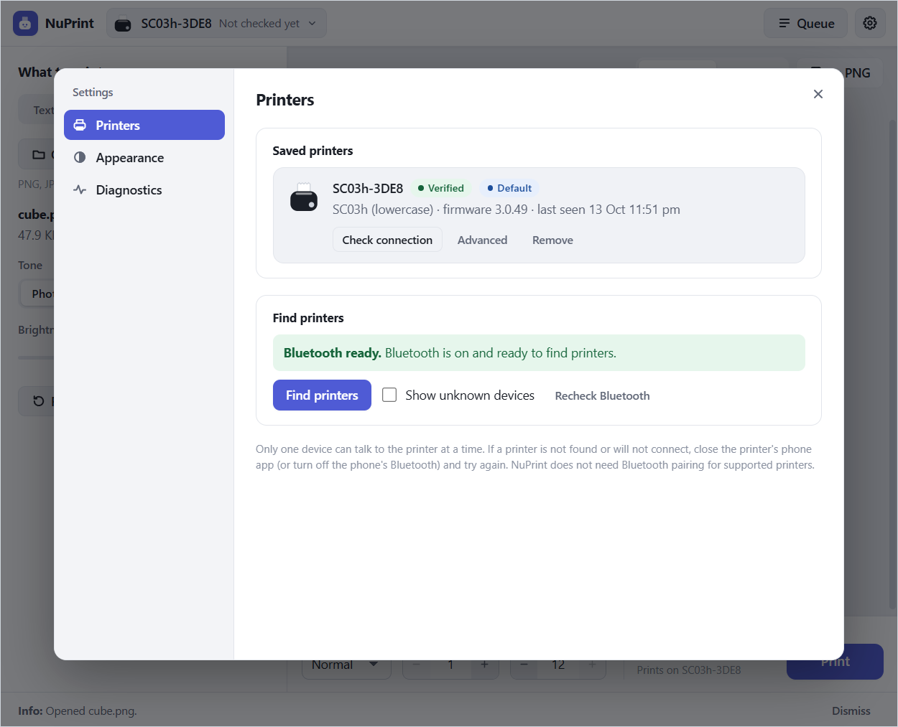
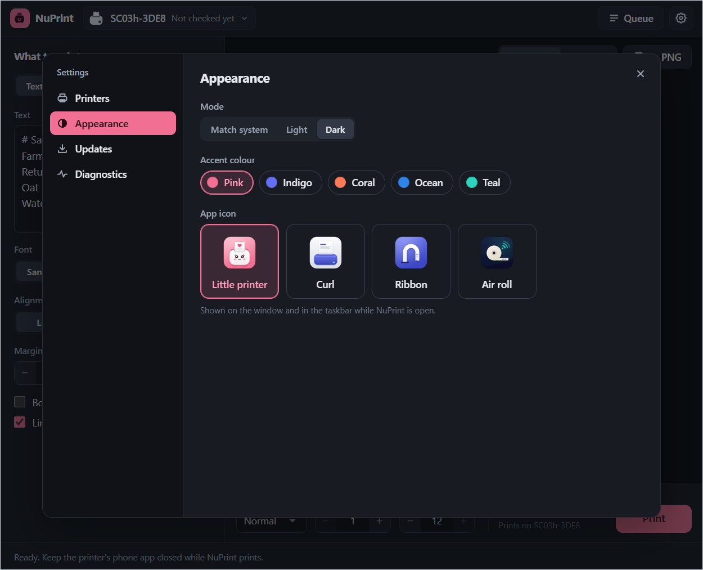

# NuPrint user guide

How to install NuPrint, print with it, and fix the common problems. For the command-line tool, see [printer interaction](printer-interaction.md).

## Supported printers

- **SC03h** (lowercase, names starting `SC03h-`): verified on Windows and macOS; experimental on Linux.
- **Experimental models:** printers whose settings in the vendor's Android app are identical to the SC03h's. NuPrint offers them with an **Experimental** badge, and saving one asks you to confirm (`--allow-experimental` in the CLI). They use the SC03h's tested settings with their own exact name match, and a printer must still show the expected Bluetooth print service before anything is sent. If you try one, please share a diagnostics export and whether the paper looked right. For a model NuPrint doesn't list, `nuprint inspect --device NAME --output inspect.json` records its Bluetooth services without sending it any printer command. The list and the evidence behind it are in [the APK printer catalog](apk-printer-models.md).
- **Everything else**, including uppercase variants such as `SC03H-` or `X6H-` (different heat settings), shows as an unknown device and is never sent print commands.

What has been tested on which system is recorded in [validation](validation.md#current-status).

## Installing

Download the installer for your system from [Releases](https://github.com/wapenshaw/nuprint/releases), and check it against `SHA256SUMS` if you like:

| System | File |
| --- | --- |
| Windows 10/11 (x64) | `NuPrint_<version>_x64-setup.exe`, installs for the current user without admin rights |
| macOS 14+, Apple silicon | `NuPrint_<version>_aarch64.dmg` |
| macOS 14+, Intel | `NuPrint_<version>_x64.dmg` |
| Debian/Ubuntu (x64) | `NuPrint_<version>_amd64.deb`, installs BlueZ as a dependency |

The installers are not code-signed yet. On Windows, SmartScreen may warn about an unrecognised app: choose **More info → Run anyway**. On macOS, the first launch is blocked: open **System Settings → Privacy & Security** and choose **Open Anyway** for NuPrint. To check that an installer was built by NuPrint's release workflow, see [check a download](code-signing.md#check-a-download). The `nuprint` CLI is built from source (see [building from source](building.md)).

Each release also carries a preview of the app drawn with Slint, as `nuprint-slint_<version>_x64-setup.exe`, `nuprint-slint_<version>_aarch64.dmg`, `nuprint-slint_<version>_x64.dmg` and `nuprint-slint_<version>_amd64.deb`. It installs as **NuPrint Slint** beside NuPrint and keeps its own printers and queue. It is a preview: it has not been tested with a printer from an installer, and the [Slint notes](building.md#slint-app) list what it lacks.

## Using the desktop app

NuPrint is one window. On the left is what to print, on the right its paper preview with the print bar underneath. The toolbar holds the printer button, **Queue** and **Settings** (Ctrl+, or ⌘,). The queue slides in over the preview, and settings open on top. Neither moves anything in the window.

1. Turn on the printer, load thermal paper and close any phone printer app.
2. Open the printer button in the toolbar and choose **Find printers…**. In **Settings → Printers**, press **Save printer** on the found `SC03h-…` device (or a listed experimental model, after confirming). **Check connection**, in the printer menu or beside the saved printer, reads its status without moving paper. The light on the little printer shows the result in the toolbar, the menu and the printer list: green for ready, amber for a problem such as no paper, red for no connection. With several printers saved, the menu picks the one jobs go to.
3. Write a note, or open a picture or one PDF page. The preview is the exact bitmap that will be printed, repeated for each copy and followed by the extra feed as blank paper, with a millimetre ruler alongside.
4. In the print bar, choose darkness, copies and extra feed (0–12 mm), then **Print**. The bar shows how much paper the job will use. **Save as PNG** (the save icon) above the preview writes the exact bitmap to a file.

### The queue

After **Print**, the status bar at the bottom shows the latest job's state and data transfer, with **Cancel** while it can still be cancelled. It stays there with the outcome until the next message or **Dismiss**; **View queue** opens the full history in the **Queue** panel. Each job there shows its receipt. Waiting, failed and uncertain jobs keep their print data so they can be printed again. A completed job's print data is deleted, but its details and a preview of its first page stay for 30 days, until you remove the job or clear history. That preview can show what was printed, so remove the job if that matters. A job with no preview shows blank paper of the length it used.

Jobs go to a durable queue, so they survive restarts. If the app stops during a transfer, the job is marked **uncertain** and never resent automatically; check the paper and retry if needed. "Transfer complete · printer reports ready" means the printer accepted the data and reported ready, not that someone saw the paper.

If NuPrint's own queue worker fails (an internal error, not a printer problem), the queue shows **Queue stopped** and the status bar reports it. From then on NuPrint starts no job, accepts no new one, refuses **Resume queue** and does not use Bluetooth, even for **Check connection**, because it cannot prove the failed worker released the printer. Waiting jobs are kept. A job that was already claimed is marked **uncertain** (check the paper; it is not resent); if that cannot be saved, the next start marks it uncertain. **Restart NuPrint** to recover: waiting jobs then come back held until you resume them. The queue worker is not restarted inside a running app.

### Advanced printer settings

For an experimental printer, or the SC03h, **Settings → Printers → Advanced** edits that printer's values: heat per darkness level, print speed, chunk size, pacing and every other tunable setting. Common ones have their own boxes; everything else is in the JSON below them. Edits belong to that saved printer on this computer, are always shown as **Experimental**, and never change the built-in profile. How the printer is recognised (name match, protocol) cannot be edited. **Reset to defaults** goes back to the built-in values, and **Export profile…** writes the saved settings as a complete profile file. Test with one short strip after each change. A wrong value can fail or waste paper.

### Appearance

**Settings → Appearance** picks the mode (match the system, light or dark), the accent colour (indigo, coral, ocean or teal) and the app icon (little cube, curl, ribbon or air roll). Light or dark also applies to the window's title bar. The chosen icon replaces the little cube in the Dock (macOS) or on the window and taskbar while NuPrint is open. Finder, Launchpad and shortcuts keep the little cube. All three choices are remembered.

### Diagnostics

Diagnostics can be exported from **Settings → Diagnostics**. Device names, addresses, job titles, names you gave edited printer settings, and backend error details (including in the log) are redacted unless you choose to include them. Documents are never uploaded anywhere.

The app also keeps a log file at `logs/nuprint.log` in its data folder, with `nuprint.log.1` as the previous 2 MB. A background thread writes it, so a crash or forced kill can lose the most recent lines; they are written when the app quits normally and before a diagnostics export. If lines arrive faster than the disk accepts them, or the file cannot be written, informational lines are dropped before warnings and errors and the log reports how many were lost. The on-screen log and the diagnostics export are unaffected. The log file itself is not redacted.

## Troubleshooting

- **Not found:** make sure Bluetooth is on, power-cycle the printer, keep it close and close phone printer apps that may hold the connection.
- **Connected, but no status:** power-cycle the printer and check the connection again. NuPrint never pairs or unpairs devices; removing a stale Windows pairing can help.
- **Blank paper:** the thermal side must face the print head.
- **Stops halfway:** check paper, lid and charge. NuPrint honours the printer's buffer pause/resume signals. Cancelling stops further transfer, but already buffered rows may still print.
- **macOS:** the first time you press **Find printers**, macOS asks whether NuPrint may use Bluetooth; choose **Allow**. If access was refused, **Settings → Printers** says so and offers **Open Bluetooth settings** (Privacy & Security → Bluetooth): turn NuPrint on there and find printers again.

For symptoms seen from the command line, see [diagnose by symptom](printer-interaction.md#diagnose-by-symptom).
